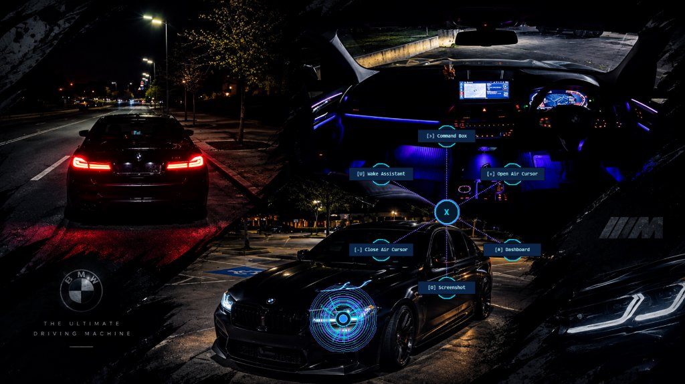
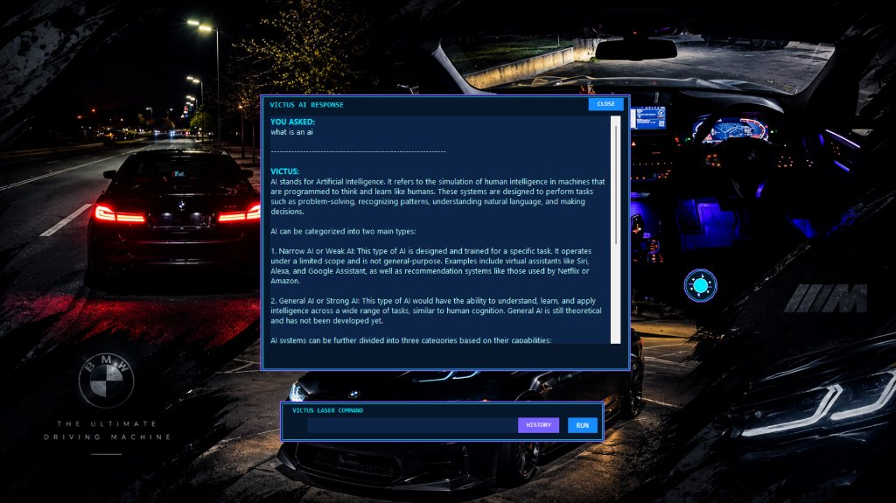
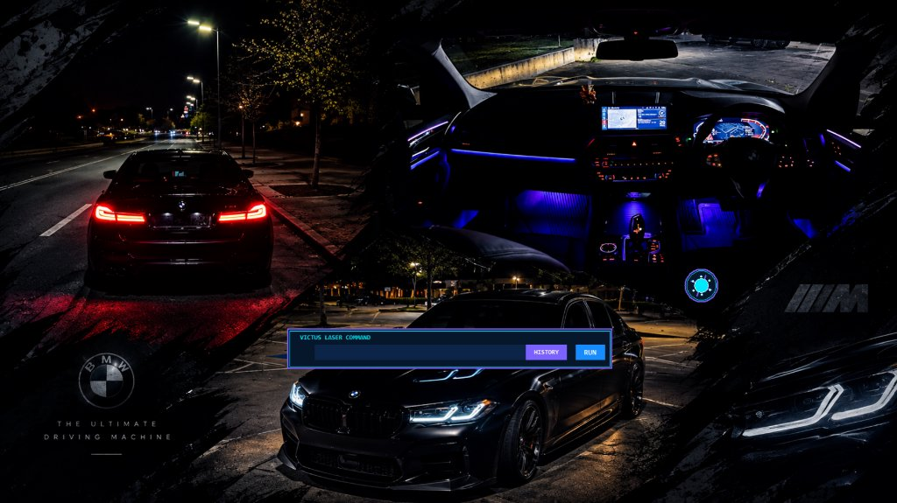

# 🎙️ Victus Voice Assistant

> **An advanced, fully offline AI desktop assistant featuring camera-based Air Cursor gesture control, local LLM intelligence, universal application launching, voice macros, and complete system automation.**

Developed by **Shreeskanda**, Victus is engineered to streamline your desktop workflow completely offline — keeping your data private, secure, and fast without requiring an active internet connection.

---

## 📸 Interface Showcase

| **Radial Quick-Action Menu** | **AI Response Window** |
|:---:|:---:|
|  |  |
| *One-click radial menu for instant access to assistant tools* | *Clean cyberpunk UI displaying local LLM dialogue & responses* |

| **Laser Command HUD** | **Glowing Particle Orb** |
|:---:|:---:|
|  |  |
| *Command bar with command history and offline math engine* | *Floating, draggable, non-intrusive glowing desktop particle orb* |

---

## ✨ Key Features

### 🧠 1. Fully Offline Local AI
- **Powered by Ollama**: Integrates seamlessly with local open-source models (Llama 3.2, TinyLlama, etc.).
- **Smart Memory & Profiles**: Persistent conversation memory across sessions and personal profile customization.
- **Tone-Aware Speech**: Situational emotional TTS synthesis (urgent, apologetic, celebratory, serious, neutral) via Windows SAPI.

### ✋ 2. Air Cursor (Hand Gesture Control)
Control your Windows mouse cursor using only your webcam and hand gestures via MediaPipe:
- **Move Cursor**: Point and guide with your index finger (adaptive smoothing filters hand tremor).
- **Left Click**: Quick index-to-thumb pinch and release.
- **Drag & Select**: Hold index-to-thumb pinch and move.
- **Right Click**: Middle-finger-to-thumb pinch.
- **Scroll**: Raise index and middle fingers together.
- **Copy / Paste**: Hold 3 fingers up to Copy (`Ctrl+C`); hold 4 fingers up to Paste (`Ctrl+V`).
- **Minimize All**: Form a closed fist to minimize desktop windows silently.
- **Restore / Maximize**: Open straight palm to restore/maximize the active application.

### 💬 3. Laser Command Box & Floating Orb
- **Futuristic Floating HUD**: Click-through, draggable glowing particle orb with quick-action radial menu.
- **Laser Command Box**: Type or speak commands with built-in safe offline mathematical calculation (`+`, `-`, `*`, `/`, `^`, `%`, `sqrt`, etc.), web search, and AI queries.
- **Command History**: Cycle through previous commands easily with the history viewer.

### 🚀 4. Universal Application Launcher
- **Dynamic System Discovery**: Automatically indexes and launches any installed Windows application, `.lnk` shortcut, or executable across your drives.
- **Windows Store & UWP Apps**: Directly opens modern Windows apps (e.g., Settings, Calculator, Camera, WhatsApp, Spotify, Paint).
- **System Utilities & Fallbacks**: Access Windows tools like Task Manager, Control Panel, Device Manager, or fallback web services.

### ⚙️ 5. System Automation & Controls
- **Window Management**: Maximize, minimize, close, or list active application windows.
- **Hardware Controls**: Adjust volume, mute/unmute, and control display brightness.
- **Media Controls**: Play, pause, next track, previous track, and random music playback.
- **Push-to-Talk Hotkey**: Instant wake via `Ctrl + Alt` shortcut.

### 🗂️ 6. Productivity & Networking
- **Voice Macros**: Record multi-step sequences of commands and replay them on demand.
- **Notes & To-Do Lists**: Dictate quick notes, manage daily tasks, and search saved notes via keyword search.
- **Scheduled Reminders**: Set time-based reminders and scheduled alerts.
- **Network Tools**: Wake-on-LAN (magic packet transmitter) and LAN device scanner.

---

## 🚀 Getting Started

### Prerequisites
- **Operating System**: Windows 10 or Windows 11 (64-bit)
- **Python**: Version 3.10 – 3.12 recommended
- **Webcam & Microphone**: Required for Air Cursor gesture tracking and voice recognition
- **Ollama (Optional, for Local LLM)**: Install [Ollama](https://ollama.ai) and pull a model:
  ```bash
  ollama pull llama3.2
  ```

### Installation

1. **Clone the repository**:
   ```bash
   git clone https://github.com/Shreeskanda/Victus-Voice-Assistant.git
   cd Victus-Voice-Assistant
   ```

2. **Install Python dependencies**:
   ```bash
   pip install opencv-python mediapipe numpy psutil sounddevice pywin32 pycaw comtypes vosk
   ```

3. **Download Offline Models**:
   - The lightweight Vosk speech model is included in `vosk-model-small-en-us-0.15/`.
   - MediaPipe Hand Landmarker model is included (`hand_landmarker.task`).
   - Run `python download_model.py` if you wish to download the optional TinyLlama GGUF model.

---

## 🎮 Usage

Launch the assistant:
```bash
python Victus_Ollama_Integrated.py
```
*Or simply double-click `run_v_ollama.bat`.*

### Useful Voice & Typed Commands
| Category | Example Commands |
|---|---|
| **Air Cursor** | `"open air cursor"`, `"close air cursor"`, `"calibrate air cursor"` |
| **System** | `"set volume to 50"`, `"mute"`, `"brightness up"`, `"take a screenshot"` |
| **Apps** | `"open chrome"`, `"open spotify"`, `"open settings"`, `"open whatsapp"` |
| **Math & Calculation** | `5 + 5`, `100 / 4`, `(12 + 8) * 3`, `calculate 25 * 4`, `2^8` |
| **AI Questions** | `"what is quantum computing?"`, `"explain C++"`, `"solve 2x + 5 = 15"` |
| **Macros** | `"record macro"`, `"stop recording"`, `"run macro workspace"` |
| **Notes & Reminders** | `"take a note: buy groceries"`, `"remind me to drink water in 30 minutes"` |

---

## 👨‍💻 Author

Developed with ❤️ by **Shreeskanda**  
- GitHub: [@Shreeskanda](https://github.com/Shreeskanda)
- Email: nshreeskanda@gmail.com

---

## 📄 License

This project is licensed under the [MIT License](LICENSE).
